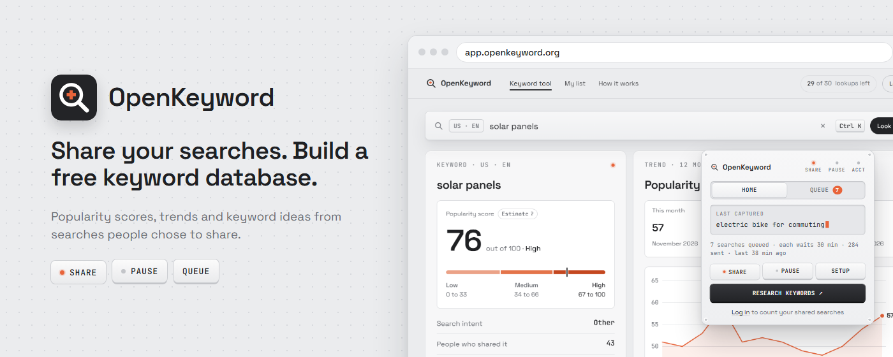

# OpenKeyword Chrome extension

[](https://chromewebstore.google.com/detail/openkeyword-free-keyword/djonglgibnggbehnimebhiolcimmdeil)
[](https://chromewebstore.google.com/detail/openkeyword-free-keyword/djonglgibnggbehnimebhiolcimmdeil)
[](LICENSE)

[](https://openkeyword.org)

**Share your searches. Build a free keyword database.**

The open-source browser extension behind [OpenKeyword](https://openkeyword.org), free keyword
research (popularity score, intent, 12-month trend and related ideas) built from searches people
choose to share. Every search you share makes the data better for everyone, and no one's search
history is ever stored.

**[Install from the Chrome Web Store](https://chromewebstore.google.com/detail/openkeyword-free-keyword/djonglgibnggbehnimebhiolcimmdeil)** ·
**[Research keywords](https://openkeyword.org)** ·
[Privacy policy](https://openkeyword.org/privacy) ·
[Source on GitHub](https://github.com/CincaAlex/openkeyword-extension)

## How it works

1. Install it. Sharing is **off** until you switch it on.
2. Search as usual on Google, Bing, DuckDuckGo, YouTube or Amazon. The extension reads only the
   search words, cleans them on your device and holds each one for 30 minutes so you can remove it.
3. Searches are sent in small batches. A keyword appears on OpenKeyword only after 5 different
   people searched it.

Keyword research itself happens on the website; the popup links to it.

## Privacy model

- Sharing is off after install. Nothing is read until you switch it on, and Chrome asks you for
  access to the five search sites at that moment.
- Only the search words are read, from the URL of a search results page. No page content, no
  browsing history, no other sites.
- Each search is checked on the device first. Queries with URLs, emails, phone numbers, long
  numbers, search operators or sensitive topics (health, adult, legal, money trouble, people
  lookups) are dropped.
- What is sent per search is exactly `{ kw, country, lang }`. No URL, timestamp or engine name.
  Each request also carries a random install key (in a header, not in the items), which the server
  keeps only as a keyed hash for counting contributions.
- Searches wait at least 30 minutes, plus a random delay, before they are sent. You can see and
  remove them in the popup while they wait.
- Incognito windows are never read.
- Delete my data (Settings) clears everything local and asks the server to delete this install's
  contribution counter.
- Logging in is optional. It only lets the server count how many searches your account shared,
  never which ones.

[docs/PRIVACY.md](docs/PRIVACY.md) has the full details.

## Permissions

| Permission | When | Why |
|---|---|---|
| `storage` | Install | Settings, the waiting queue, a random install key and local stats |
| `alarms` | Install | Checks every 5 minutes for searches that have waited long enough to send |
| `https://app.openkeyword.org/*` | Install | The OpenKeyword API that receives contributions |
| `https://www.google.com/*`, `https://www.bing.com/*`, `https://duckduckgo.com/*`, `https://www.youtube.com/*`, `https://www.amazon.com/*` | Only when you turn sharing on | Reading the search words from result page URLs. Removed again when you turn sharing off |

The extension does not request `tabs`, does not inject content scripts, loads no remote code and
does not use `eval`.

## Build

Requires Node.js 22.12 or newer.

```sh
npm install
npm run typecheck   # tsc --noEmit
npm test            # vitest unit tests
npm run build       # dev build  -> dist/  (API http://localhost:8787)
npm run build:prod  # prod build -> dist/  (API https://app.openkeyword.org)
npm run watch       # dev build, rebuilds on change
npm run zip         # prod build + release/openkeyword-<version>.zip
```

`build.mjs` bundles the TypeScript with esbuild, copies `static/`, draws the icons, copies the two
bundled fonts (Space Grotesk, JetBrains Mono) from `@fontsource` and writes `dist/manifest.json`.

The dev build is named "OpenKeyword (dev)", has source maps, host access to `http://localhost/*`
and `http://127.0.0.1/*`, a Developer section in Settings to change the API base, and a
"Send now (dev)" button that skips the 30-minute hold.

### Environment variables

All are optional and read at build time.

| Variable | Default (dev / prod) | Used for |
|---|---|---|
| `VITE_API_BASE` | `http://localhost:8787` / `https://app.openkeyword.org` | Sending contributions. Its origin is the only install-time host permission |
| `VITE_WEB_BASE` | `http://localhost:5173` / `https://app.openkeyword.org` | Links to the website (research, feedback, uninstall survey) |
| `VITE_SITE_BASE` | `http://localhost:4321` / `https://openkeyword.org` | Privacy policy links and the manifest's `homepage_url` |
| `VITE_SOURCE_URL` | empty | Public source repository (must be `https://`). When set, the pages show an "open source" line and the store summary uses its open-source wording |

## Load unpacked

1. Run `npm run build` (or `npm run build:prod`).
2. Open `chrome://extensions` and turn on Developer mode.
3. Click Load unpacked and select the `dist` folder.
4. The welcome page opens. Turn on sharing there or from the popup.

After a rebuild, click the reload icon on the extension's card. To inspect the background worker,
click the "service worker" link on that card. Chrome 116 or newer is required.

## Verifying the store build

The output is bundled but not minified, so the published package can be compared with this source.

1. Install the extension from the Chrome Web Store and find its folder: open
   `chrome://version`, note the Profile Path, then look in
   `<profile>/Extensions/<extension id>/<version>/`.
2. Check out the tag for that version and run `npm ci && npm run zip`.
3. Unpack `release/openkeyword-<version>.zip` and diff it against the installed folder. Chrome
   adds a `_metadata` folder to installed extensions; ignore it.

The zip step refuses dev builds and source maps, and writes files in a fixed order with a fixed
timestamp, so the same source gives the same files.

## Project layout

```
build.mjs              build script: esbuild bundling, manifest, icons, locales, release zip
src/background.ts      service worker: install key, passive capture, queue and sending
src/popup.ts           toolbar popup: sharing switch, pause, stats, waiting list, settings
src/onboarding.ts      welcome page shown once after install
src/login.ts           optional login tab (email and 6-digit code)
src/config.ts          build-time constants
src/hosts.json         the optional search hosts, used by the code and the manifest
src/lib/               queue rules, URL extraction, API client, chrome.* wrappers
src/ui/                DOM helpers and the sharing switch
src/i18n/              translations for the extension pages
shared/                keyword normalization, scrubbing, login client and i18n helpers
static/                HTML and CSS
store-listing/         store name and summary per language (written to _locales)
test/                  vitest unit tests
docs/PRIVACY.md        permissions and data flow in detail
```

## Contributing and security

See [CONTRIBUTING.md](CONTRIBUTING.md). Please report security issues privately as described in
[SECURITY.md](SECURITY.md).

## License

Apache License 2.0, see [LICENSE](LICENSE) and [NOTICE](NOTICE).

The license does not grant rights to the OpenKeyword name or logo. If you publish a fork, give it
a different name and icon.
